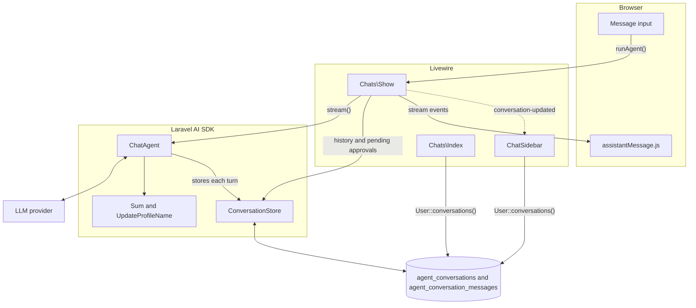
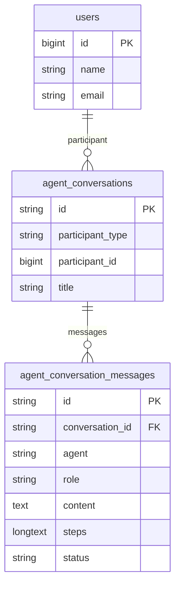
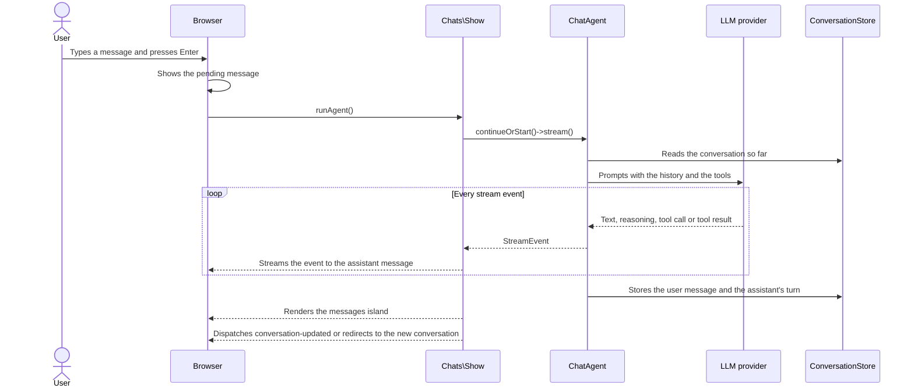
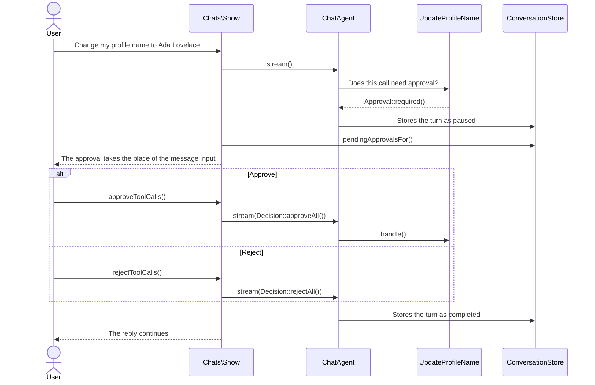

# Livewire Chat Kit

[](https://packagist.org/packages/kauffinger/livewire-chat-kit)
[](https://github.com/kauffinger/livewire-chat/actions?query=workflow%3Atests+branch%3Amain)
[](https://github.com/kauffinger/livewire-chat/actions?query=workflow%3Alint+branch%3Amain)
[](https://packagist.org/packages/kauffinger/livewire-chat-kit)

A Laravel starter kit for an LLM chat interface, built with Livewire, [FluxUI](https://fluxui.com), and the [Laravel AI SDK](https://laravel.com/docs/ai-sdk).

The chat streams replies, renders markdown, calls tools, asks the user before a tool changes something, and stores every conversation. Apart from the Alpine component that renders streamed markdown, it is written in PHP and Blade.

> [!NOTE]
> Version 3 is built on the Laravel AI SDK. The SDK stores conversations and messages, so the kit no longer ships its own `Chat` and `Message` models. Versions 1 and 2 were built on [Prism](https://prismphp.com). The last Prism release is the `v2.0.1` tag.

## Features

### Conversations

- **Multiple Conversations:** Start a conversation, come back to it later, and switch between conversations
- **Sidebar:** The 30 most recent conversations, grouped by date. It collapses to a rail and stays in place while you navigate
- **Search:** Find a conversation by its title
- **History:** The AI SDK stores every conversation in the database

### LLM

- **Streaming:** Replies appear while the model writes them, through Livewire streams
- **Providers:** OpenAI by default. Any provider in `config/ai.php` can be used instead, including OpenAI-compatible gateways and local model servers
- **Tools:** The model can call PHP classes as tools. Each call is shown with its arguments and result
- **Tool Approval:** A tool that changes something waits until the user approves or rejects the call

### Interface

- **FluxUI:** Built from Flux components and styled with Tailwind CSS and its typography plugin
- **Markdown:** Replies are rendered with markdown-it, and code blocks are highlighted with highlight.js

## Installation

Create a new Laravel application from the kit with the Laravel installer:

```bash
laravel new my-chat-app --using=kauffinger/livewire-chat-kit
```

Then:

1.  Run migrations: `php artisan migrate`
2.  Install NPM dependencies: `npm install`
3.  Build assets: `npm run dev` (or `npm run build` for production)

## Getting Started

### Configure the LLM Provider

The chat talks to OpenAI by default. Add your API key to `.env`:

```env
OPENAI_API_KEY=your-openai-api-key
```

To use another provider or model for the chat, add attributes to the agent. For example, Claude:

```php
// In app/Ai/Agents/ChatAgent.php
use Laravel\Ai\Attributes\Model;
use Laravel\Ai\Attributes\Provider;
use Laravel\Ai\Enums\Lab;

#[Provider(Lab::Anthropic)]
#[Model('claude-sonnet-5-5')]
class ChatAgent implements Agent, Conversational, HasTools
{
    // ...
}
```

That provider's API key goes in `.env` as well, `ANTHROPIC_API_KEY` in this case.

To change the default provider without touching the agent, set `AI_PROVIDER` to any provider in `config/ai.php`. This is also how you point the chat at an OpenAI-compatible gateway or a local model server:

```env
AI_PROVIDER=openai-compatible
OPENAI_COMPATIBLE_URL=https://your-gateway.example/v1
OPENAI_COMPATIBLE_API_KEY=your-gateway-key
OPENAI_COMPATIBLE_MODEL=your-model
```

### Open the Chat

Open `/dashboard`. It redirects to your last conversation, or to a new one when you have none. From there you can:

- Start a new conversation from the sidebar
- Switch between conversations, or search them by title
- Ask the assistant to add two numbers, which calls the example `Sum` tool
- Ask the assistant to change the name on your profile, and approve or reject the tool call it asks for

## Architecture



### Core Components

- **`app/Ai/Agents/ChatAgent.php`** - The agent: instructions, tools, and conversation memory
- **`app/Ai/Tools/Sum.php`** - Example tool the agent can call
- **`app/Ai/Tools/UpdateProfileName.php`** - Example tool that needs the user's approval before it runs
- **`app/Livewire/Chats/Index.php`** - Paginate over all of your conversations
- **`app/Livewire/Chats/Show.php`** - Main chat component handling LLM streaming and message display
- **`app/Livewire/ChatSidebar.php`** - Conversation navigation and history
- **`resources/js/components/assistantMessage.js`** - Alpine component that renders an assistant message, stored or streaming

### The Agent

The chat is one agent class. The `Promptable` trait adds `prompt()` and `stream()`. With `RemembersConversations`, the SDK loads the conversation before each prompt and stores the turn after it.

```php
// app/Ai/Agents/ChatAgent.php
#[MaxSteps(5)]
class ChatAgent implements Agent, Conversational, HasTools
{
    use Promptable;
    use RemembersConversations;

    /**
     * Get the instructions that the agent should follow.
     */
    public function instructions(): Stringable|string
    {
        return 'You are a helpful assistant.';
    }

    /**
     * Get the tools available to the agent.
     *
     * @return list<Agent|Tool|ProviderTool>
     */
    public function tools(): iterable
    {
        return [
            new Sum,
            new UpdateProfileName,
        ];
    }
}
```

### Conversations

Conversations and messages belong to the AI SDK. The app never creates them itself: the SDK creates a conversation and gives it a title when its first message is answered, and stores every turn after that.



The `User` model lists its conversations with the SDK's `HasConversations` trait, and the chat reads a conversation's history through the SDK's `ConversationStore`:

```php
// app/Models/User.php
final class User extends Authenticatable
{
    use HasConversations;
}

// app/Livewire/ChatSidebar.php
Auth::user()->conversations()->latest('updated_at')->limit(30)->get();

// app/Livewire/Chats/Show.php
resolve(ConversationStore::class)->paginateConversationMessages($this->conversationId, $this->messagesPerPage);
```

A conversation can only be opened by the user it belongs to. `Chats\Show` aborts with a 403 for anyone else.

Titles are written by the provider's cheapest model. Set `ai.conversations.generate_title` to `false` in `config/ai.php` to use the start of the first message instead.

### UI Components

- **Chat Interface:** Real-time streaming with markdown rendering. Text is revealed at an even pace, new words fade in, and markdown that is still being written (half a bold word, link or table) is closed or hidden until it completes
- **Status Row:** Shows "Thinking…", the tool that is running, and the latest line of reasoning when the model streams it
- **Tool Calls Display:** Each tool call is a row that opens to show its arguments and result
- **Tool Approval:** A tool call that needs approval takes the place of the message input until you approve or reject it
- **Message Input:** Sits in the middle of a new conversation and docks to the bottom once it starts. It grows with the text, Enter sends and Shift+Enter starts a new line. While a reply streams, the send button becomes a stop button
- **Code Blocks:** Show their language and a copy button
- **Earlier Messages:** Loaded when you scroll to the top of a conversation
- **Toast Notifications:** Flux toasts, for example when the provider fails

## Message Flow



1. **User Input:** The user types a message and submits it
2. **Pending Message:** The browser moves the message from the input into `pendingMessage`, which shows it right away, and calls `runAgent()` in the same request. This is the `send` JavaScript action at the bottom of `show.blade.php`
3. **LLM Streaming:** `runAgent()` continues the conversation with `ChatAgent`, or starts one, and streams the response
4. **Stream Handling:** `Chats\Show` streams each of the SDK's events (text, reasoning, tool calls, results) to the browser as it arrives
5. **UI Updates:** The `assistantMessage` Alpine component adds each event to the reply it is showing. It morphs the reply instead of replacing it, and `resources/js/completeMarkdown.js` repairs unfinished markdown. The stored messages live in a Livewire island, so sending a message does not render them again. When the turn ends before the reveal has caught up, the stored message continues it
6. **Persistence:** The AI SDK stores the user message and the assistant's turn when the response completes
7. **Stopping:** The `stop` JavaScript action cancels the streaming request and returns the message to the input, without another request. The SDK only stores a turn that completes, so a stopped reply is discarded
8. **Failures:** If the provider fails, the message returns to the input and a toast tells the user. A turn that failed after running tools is kept by the SDK and marked in the history

Steps 3 to 5 are one loop in `Chats\Show`. Here it is without the error handling:

```php
// app/Livewire/Chats/Show.php
protected function streamAgent(Decisions|string $prompt): void
{
    $stream = ChatAgent::make()
        ->continueOrStart($this->conversationId, as: Auth::user())
        ->stream($prompt);

    foreach ($stream as $event) {
        $this->stream(to: 'reply', content: $event->toArray());
    }

    $this->renderIsland('messages');

    if ($this->conversationId === null) {
        $this->redirectRoute('conversation.show', $stream->conversationId, navigate: true);

        return;
    }

    $this->dispatch('conversation-updated');
}
```

Each event reaches the browser in the SDK's own format, for example `{"type": "text_delta", "delta": "Hello"}`. The streaming assistant message listens for them with a Livewire message interceptor and adds each one to the message it renders:

```js
// resources/js/components/assistantMessage.js
this.$wire.$interceptMessage(({ onStream }) => {
    onStream(({ json }) => this.receive(json.content));
});

receive(event) {
    switch (event.type) {
        case 'text_delta':
            this.message.content += event.delta;
            break;
        case 'reasoning_delta':
            this.message.reasoning += event.delta;
            break;
        case 'tool_call':
            // Adds the tool call to the message.
        case 'tool_result':
            // Adds the result to the tool call it belongs to.
    }
}
```

A stored message is the same component. It gets the whole message from Blade instead of from the stream:

```blade
{{-- resources/views/livewire/chats/show.blade.php --}}
<x-chat.assistant-message :message="$message" />

<x-chat.assistant-message streaming />
```

## Tools

- **Definitions:** Tools live in `app/Ai/Tools` and are registered in `ChatAgent::tools()`. Create new ones with `php artisan make:tool`
- **Execution:** The model decides when to call a tool. The SDK runs it and returns the result to the model, for up to five steps per turn (`#[MaxSteps(5)]` on the agent)
- **Display:** Tool calls are shown while the reply streams and in the conversation history
- **Approval:** A tool that implements the SDK's `Approvable` contract pauses the turn. The chat shows the call with its arguments and resumes the turn once the user approves or rejects it

A tool is a description, a schema and a `handle()` method:

```php
// app/Ai/Tools/Sum.php
class Sum implements Tool
{
    /**
     * Get the description of the tool's purpose.
     */
    public function description(): Stringable|string
    {
        return 'Sums two numbers together.';
    }

    /**
     * Execute the tool.
     */
    public function handle(Request $request): Stringable|string
    {
        return (string) ($request->float('a') + $request->float('b'));
    }

    /**
     * Get the tool's schema definition.
     */
    public function schema(JsonSchema $schema): array
    {
        return [
            'a' => $schema->number()->description('The first number to sum.')->required(),
            'b' => $schema->number()->description('The second number to sum.')->required(),
        ];
    }
}
```

### Approval

A tool that changes data can ask for the user's approval first. Implement `Approvable` and the SDK pauses the turn before the tool runs:

```php
// app/Ai/Tools/UpdateProfileName.php
class UpdateProfileName implements Approvable, Tool
{
    use InteractsWithApprovals;

    /**
     * Execute the tool.
     */
    public function handle(Request $request): Stringable|string
    {
        $validated = $request->validate([
            'name' => ['required', 'string', 'max:255'],
        ]);

        Auth::user()->update($validated);

        return "The profile name is now {$validated['name']}.";
    }

    /**
     * Determine whether the tool needs approval for the given request.
     */
    protected function needsApproval(Request $request): Approval|bool
    {
        return Approval::required(__('This will change the name on your profile.'));
    }
}
```



The decision resumes the turn through the same `streamAgent()` method a message uses:

```php
// app/Livewire/Chats/Show.php
public function approveToolCalls(): void
{
    if ($this->pendingApprovals === []) {
        return;
    }

    $this->streamAgent(Decision::approveAll());
}

public function rejectToolCalls(): void
{
    if ($this->pendingApprovals === []) {
        return;
    }

    $this->streamAgent(Decision::rejectAll(__('The user declined this action.')));
}
```

## Testing and Code Quality

Tests fake the agent with `ChatAgent::fake()`, so they never call a provider. `ConversationFactory` and `ConversationMessageFactory` build the SDK's models:

```php
// tests/Feature/Livewire/Chats/ShowTest.php
it('allows sending messages', function (): void {
    ChatAgent::fake(['Hello, human!']);

    $user = User::factory()->create();
    $conversation = ConversationFactory::new()->recycle($user)->create();

    actingAs($user);

    livewire(Show::class, ['conversation' => $conversation])
        ->set('pendingMessage', 'Hello, world!')
        ->call('runAgent')
        ->assertDispatched('conversation-updated');

    ChatAgent::assertPrompted('Hello, world!');

    expect($conversation->messages()->orderBy('id')->get())
        ->toHaveCount(2)
        ->sequence(
            fn ($message) => $message->role->toBe('user')->content->toBe('Hello, world!'),
            fn ($message) => $message->role->toBe('assistant')->content->toBe('Hello, human!'),
        );
});
```

A tool call that waits for approval is faked the same way:

```php
ChatAgent::fake([
    AgentResponse::fakeWithPendingApprovals([
        new PendingApproval(id: 'call_1', tool: 'UpdateProfileName', arguments: ['name' => 'Ada King']),
    ]),
    'All done.',
]);
```

Browser tests in `tests/Browser` drive Chrome through [Pest's browser plugin](https://pestphp.com/docs/browser-testing) and cover what only runs in JavaScript: sending with Enter, the rendered markdown, tool call details and loading earlier messages. They run with the rest of the suite and need Playwright's Chromium and built assets:

```bash
npx playwright install chromium
npm run build
```

Pest's test server hands a streamed reply to the browser in one piece, so the browser tests check the finished turn rather than the token stream.

The tests run with Pest. PHP is formatted with Laravel Pint and Rector, and JavaScript, CSS and Blade with Prettier:

```bash
composer test
composer format
```

## Toast Notifications

Toasts are [Flux toasts](https://fluxui.dev/components/toast). The `<flux:toast />` element lives in `resources/views/components/layouts/app/sidebar.blade.php`.

### Usage in Livewire Components

```php
use Flux\Flux;

Flux::toast(
    variant: 'success',
    heading: 'Changes saved.',
    text: 'You can always update this in your settings.',
);
```

### Usage with Alpine.js

```blade
<flux:button
  x-on:click="
    $flux.toast({
      variant: 'success',
      heading: 'Changes saved.',
      text: 'You can always update this in your settings.',
    })
  "
>
  Show Success Toast
</flux:button>
```

### Toast Options

- `variant`: 'success' | 'warning' | 'danger'
- `heading`: The title (optional)
- `text`: The message
- `duration`: Auto-dismiss after milliseconds (default: 5000, use 0 to keep it open)

## Contributing

Bug reports, feature suggestions and pull requests are welcome in the [GitHub repository](https://github.com/kauffinger/livewire-chat-kit).

## License

This project is open-sourced software licensed under the [MIT license](LICENSE.md).
